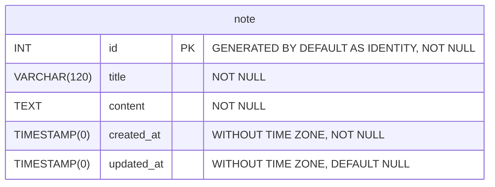

# Base de données

Ce niveau a une base de données : PostgreSQL en développement et dans le job `docker` de la CI, SQLite pendant les tests. Ce document décrit la table, sa création, et les commandes pour regarder ce qu'elle contient.

## La table `note`

Une seule table métier, créée par la migration [migrations/Version20261113114813.php](../migrations/Version20261113114813.php) à partir de l'entité [src/Entity/Note.php](../src/Entity/Note.php).



Les types sont ceux de PostgreSQL, recopiés de la requête de la migration :

```sql
CREATE TABLE note (id INT GENERATED BY DEFAULT AS IDENTITY NOT NULL, title VARCHAR(120) NOT NULL, content TEXT NOT NULL, created_at TIMESTAMP(0) WITHOUT TIME ZONE NOT NULL, updated_at TIMESTAMP(0) WITHOUT TIME ZONE DEFAULT NULL, PRIMARY KEY (id))
```

| Colonne | Type SQL | Nulle ? | Propriété PHP | Rôle |
|---|---|---|---|---|
| `id` | `INT GENERATED BY DEFAULT AS IDENTITY` | Non | `?int $id` | L'identifiant, attribué par PostgreSQL à l'insertion. Clé primaire |
| `title` | `VARCHAR(120)` | Non | `?string $title` | Le titre, 120 caractères au plus |
| `content` | `TEXT` | Non | `?string $content` | Le contenu, sans limite côté base. La limite de 10 000 caractères vient de la validation |
| `created_at` | `TIMESTAMP(0) WITHOUT TIME ZONE` | Non | `?\DateTimeImmutable $createdAt` | La date de création, remplie par `onPrePersist()` au moment du `persist()` |
| `updated_at` | `TIMESTAMP(0) WITHOUT TIME ZONE` | Oui | `?\DateTimeImmutable $updatedAt` | La date de dernière modification, remplie par `onPreUpdate()` au moment du `flush()`. Vide tant que la note n'a pas été modifiée |

Quelques points de lecture :

- **Les noms changent de forme.** La propriété `createdAt` devient la colonne `created_at`. C'est la stratégie de nommage `underscore` de [config/packages/doctrine.yaml](../config/packages/doctrine.yaml).
- **`GENERATED BY DEFAULT AS IDENTITY`** est la façon moderne de PostgreSQL de numéroter les lignes. Doctrine l'utilise parce que `doctrine.yaml` contient `identity_generation_preferences` pour PostgreSQL, posé par la recette.
- **`TIMESTAMP(0)`** garde la seconde, sans fraction. **`WITHOUT TIME ZONE`** veut dire que la base ne stocke pas de fuseau : l'heure enregistrée est celle de PHP au moment où le rappel la remplit : au `persist()` pour `created_at`, au `flush()` pour `updated_at`.
- **Les `?` des propriétés PHP** ne disent rien de la base. Ils permettent à un objet `new Note()` d'exister avant d'avoir un titre ou un identifiant. Ce qui compte pour la colonne, c'est `nullable` dans `#[ORM\Column]`, présent seulement sur `updatedAt`.

Le détail du mapping est dans [la fiche sur l'ORM et les entités](formations/01-orm-et-entites.md), celui de la migration dans [la fiche sur les migrations](formations/03-migrations.md).

## La table `doctrine_migration_versions`

La base contient une seconde table, que vous n'écrivez pas : Doctrine Migrations la crée pour noter les migrations déjà jouées. Elle a trois colonnes, `version`, `executed_at` et `execution_time`. Elle n'a pas d'entité, et `doctrine:schema:validate` sait qu'il doit l'ignorer.

## Une base, deux moteurs

| Situation | Moteur | Où est la base | Qui crée la table |
|---|---|---|---|
| `docker compose up` et le site sur <http://localhost:8080> | PostgreSQL 16 | Le volume `database_data` du service `database` | `doctrine:migrations:migrate` |
| `symfony console` sur votre machine | PostgreSQL 16 | La même, par le port publié | `doctrine:migrations:migrate` |
| `php bin/phpunit`, partout | SQLite | Le fichier `var/test.db` | `SchemaTool`, au début de chaque test |
| Job `docker` de la CI | PostgreSQL 16 | Un conteneur jetable | `doctrine:migrations:migrate` |

Avec SQLite, la même entité donne d'autres types : `INTEGER PRIMARY KEY AUTOINCREMENT`, `CLOB`, `DATETIME`. C'est pourquoi la migration, écrite pour PostgreSQL, n'est jamais jouée sur SQLite. La [fiche sur les tests](formations/07-tests-avec-base-de-donnees.md) explique ce choix et ses limites.

## Inspecter la base

Démarrez d'abord la base, puis appliquez les migrations si ce n'est pas fait :

```bash
docker compose up -d --wait database
symfony console doctrine:migrations:migrate
```

`--wait` rend la main quand le `healthcheck` du service répond, voir [docker.md](docker.md).

### Depuis Symfony

```bash
symfony console doctrine:migrations:status
symfony console doctrine:migrations:list
symfony console doctrine:schema:validate
symfony console dbal:run-sql "SELECT id, title, created_at, updated_at FROM note ORDER BY id"
```

Dans l'ordre : l'état des migrations, la liste des migrations avec leur date d'exécution, la comparaison du mapping avec la base, puis une requête SQL quelconque.

`doctrine:schema:validate` affiche deux `[OK]` quand tout va bien :

```text
Mapping
-------
 [OK] The mapping files are correct.

Database
--------
 [OK] The database schema is in sync with the mapping files.
```

Le premier dit que les attributs de l'entité sont cohérents, le second que la table réelle correspond à ces attributs.

Pourquoi `symfony console` et pas `php bin/console` ? Le port de la base sur votre machine est choisi par Docker au démarrage. Seule la Symfony CLI le découvre. La [fiche sur la connexion](formations/02-connexion-et-postgresql.md) le montre en détail.

### Depuis PostgreSQL

```bash
docker compose exec database psql -U app -d app
```

Ouvre `psql`, le client en ligne de commande de PostgreSQL, **dans** le conteneur de la base. Pas besoin du port ni du mot de passe : `psql` se connecte de l'intérieur. Quelques commandes utiles une fois dedans :

| Commande | Effet |
|---|---|
| `\dt` | Liste les tables : `doctrine_migration_versions` et `note` |
| `\d note` | Décrit la table `note` |
| `SELECT * FROM note;` | Affiche les notes. Le `;` final est obligatoire |
| `\q` | Quitte `psql` |

`\d note` affiche ceci après la migration :

```text
                                          Table "public.note"
   Column   |              Type              | Collation | Nullable |              Default
------------+--------------------------------+-----------+----------+-----------------------------------
 id         | integer                        |           | not null | generated by default as identity
 title      | character varying(120)         |           | not null |
 content    | text                           |           | not null |
 created_at | timestamp(0) without time zone |           | not null |
 updated_at | timestamp(0) without time zone |           |          | NULL::timestamp without time zone
Indexes:
    "note_pkey" PRIMARY KEY, btree (id)
```

PostgreSQL écrit les types en toutes lettres : `integer` pour `INT`, `character varying(120)` pour `VARCHAR(120)`. Ce sont les mêmes.

### Repartir de zéro

```bash
docker compose down -v
docker compose up -d --wait database
symfony console doctrine:migrations:migrate
```

`down -v` supprime le volume `database_data`, donc **toutes les notes**. Le démarrage suivant crée une base vide, et la migration recrée la table. C'est sans risque ici, où il n'y a que des données d'essai.

La base de test n'a pas besoin de cette commande : chaque test la vide et la recrée.
